[GitHub](https://github.com/SeishiKun9) · [Email](mailto:seishikun7@gmail.com)

**Quick Jump:** [seishikun9](https://github.com/SeishiKun9/seishikun9) · [SeiReminds](https://github.com/SeishiKun9/SeiReminds) · [Canvas-Notif](https://github.com/SeishiKun9/Canvas-Notif) · [Location-tracker-expirement-](https://github.com/SeishiKun9/Location-tracker-expirement-)

