[GitHub](https://github.com/seishikun) · [Email](mailto:seishikun7@gmail.com)

**Quick Jump:** [seishikun](https://github.com/seishikun/seishikun) · [nebula-ui](https://github.com/seishikun) · [orbit-api](https://github.com/seishikun) · [cosmos-cli](https://github.com/seishikun)

